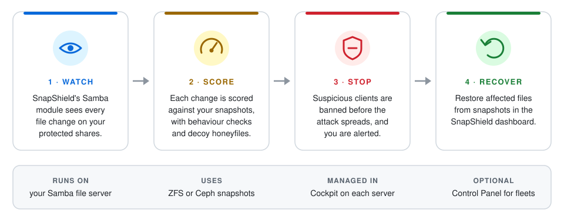

# SnapShield

SnapShield by [45Drives](https://www.45drives.com/) protects Samba file servers from ransomware. It watches file activity on your shares, scores suspicious behaviour, plants honeyfiles that no legitimate user should touch, and stops an attack before it spreads.

This repository is the public home for SnapShield's **documentation** and **bug reports**. The packages themselves come from the 45Drives package repository.

## How it works

<picture>
  <source media="(prefers-color-scheme: dark)" srcset="docs/images/how-it-works-dark.svg">
  
</picture>

## Quick start

On the file server, as root:

```bash
curl -sSL https://raw.githubusercontent.com/45Drives/SnapShield-public/main/setup.sh | sudo bash
```

This adds the 45Drives Community repository, installs [Cockpit](https://cockpit-project.org/) and the SnapShield Cockpit plugin, and turns Cockpit on. Then:

1. Open `https://<your-server>:9090` and sign in with an administrator account.
2. Choose **Snapshield Dashboard** in the menu.
3. Follow the setup wizard. It installs the rest of SnapShield and configures it.

Enterprise customers add `--enterprise`:

```bash
curl -sSL https://raw.githubusercontent.com/45Drives/SnapShield-public/main/setup.sh | sudo bash -s -- --enterprise
```

Prefer to read a script before running it? Download it first, then run it: `curl -sSLO https://raw.githubusercontent.com/45Drives/SnapShield-public/main/setup.sh && less setup.sh && sudo bash setup.sh`. Add `--dry-run` to see every change without making any. The [installation guide](docs/installation.md) covers all options and manual setup.

## Supported systems

| Operating system | Versions |
|---|---|
| Rocky Linux, RHEL, AlmaLinux | 8, 9 |
| Ubuntu | 20.04 LTS, 22.04 LTS |

## Documentation

Start with the [documentation index](docs/README.md), or jump to:

- [Installation](docs/installation.md)
- [Getting started](docs/getting-started.md)
- [SnapShield dashboard](docs/dashboard.md)
- [Control Panel](docs/control-panel.md) — manage many SnapShield servers from one place
- [Licensing](docs/licensing.md) — Community and Enterprise
- [Troubleshooting](docs/troubleshooting.md) and [FAQ](docs/faq.md)

## Community and Enterprise

| | Community | Enterprise |
|---|---|---|
| Price | Free | Paid subscription per server, with a six-month free trial |
| Ransomware protection | Included | Included |
| Control Panel management | — | Included |
| Support | Documentation, the [45HomeLab Forum](https://forum.45homelab.com/) and [GitHub issues](https://github.com/45Drives/SnapShield-public/issues) | 45Drives support at [info@45drives.com](mailto:info@45drives.com) — see [SUPPORT.md](SUPPORT.md) |

Every server starts on Community, and the license — not the package repository — decides the edition: an Enterprise license unlocks Enterprise features on a server installed from either repository. See [Licensing](docs/licensing.md) for the full comparison.

## Questions

Ask questions and get help from other users on the [45HomeLab Forum](https://forum.45homelab.com/). See [SUPPORT.md](SUPPORT.md) for all the ways to get help.

## Reporting bugs and requesting features

[Open an issue](https://github.com/45Drives/SnapShield-public/issues/new/choose) and pick a template. Please include your SnapShield version and operating system, and remove hostnames, IP addresses and license keys from any logs you paste.

**Found a security vulnerability?** Do not open a public issue. Follow [SECURITY.md](SECURITY.md) instead.

## Releases

Release notes are published under [Releases](https://github.com/45Drives/SnapShield-public/releases).
