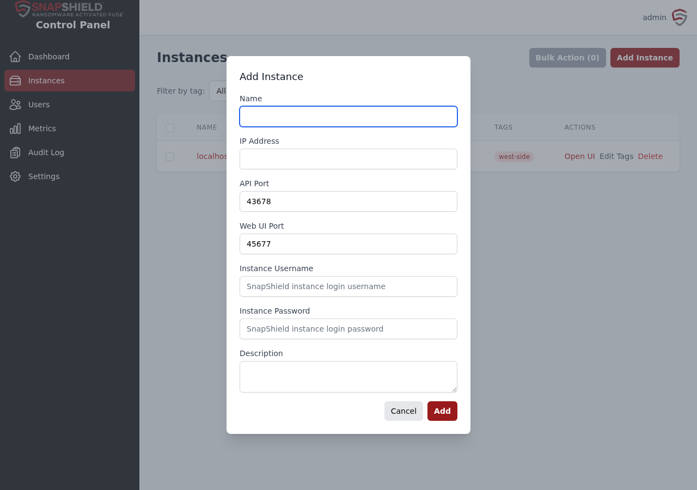
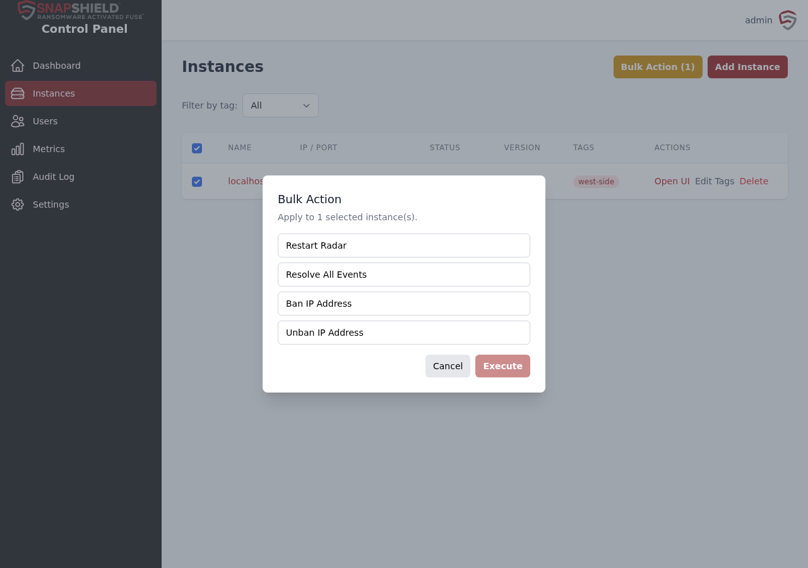
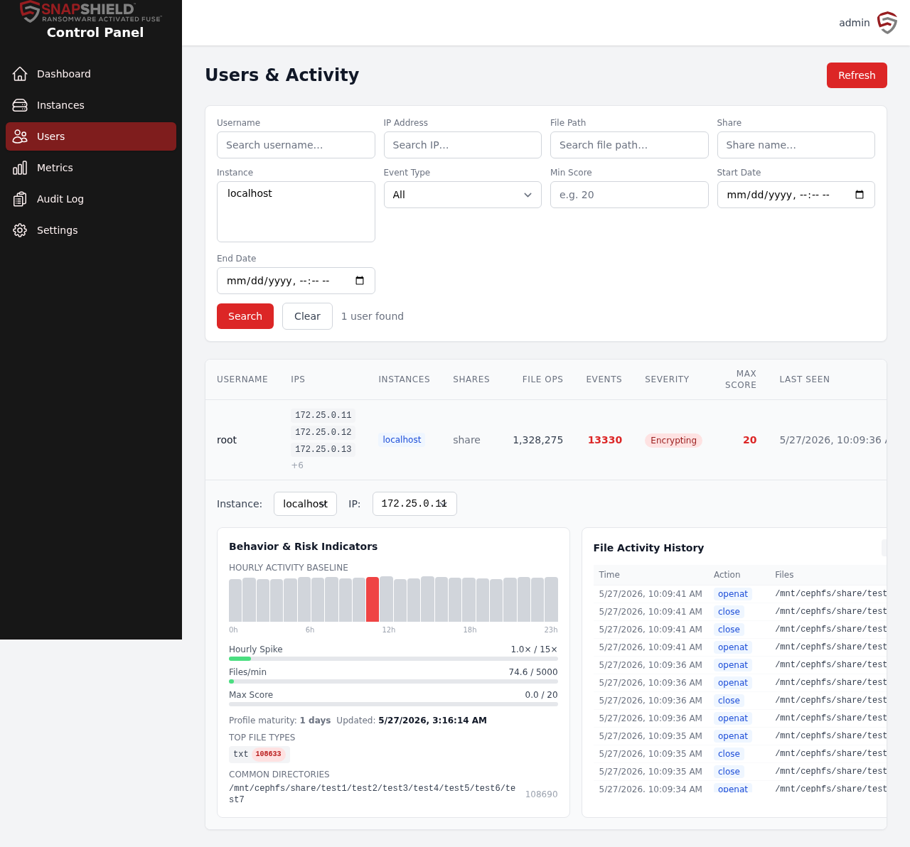

# SnapShield Control Panel guide

This guide is for administrators who manage several SnapShield servers. It covers the optional SnapShield Control Panel: signing in, adding servers, monitoring events, investigating users, and managing Control Panel accounts.

## What the Control Panel does

Each SnapShield server protects itself and has its own dashboard. The Control Panel brings them together so you can:

- See the health and active events of every server on one page.
- Ban or unban an IP address, resolve events, or restart detection on many servers at once.
- Investigate a user's file activity across all servers.
- Keep an audit log of administrative actions.

The Control Panel does not need a license of its own. Central monitoring and management of a server requires that server to be on **Enterprise** (an active Enterprise trial counts). A Community server stays listed so you can license or remove it, but it cannot be managed centrally. See [Licensing](licensing.md).

## Installing

Install the Control Panel with the same guided setup wizard used for SnapShield. In the wizard, choose **Control Panel**, or both components. To add the Control Panel to a server that already runs SnapShield, choose **Control Panel** only, so SnapShield is not set up again. See [Installation](installation.md).

The Control Panel can run on one of your SnapShield servers or on a separate host. During setup you choose its **Control Panel administrator** name and password.

## Signing in

- **In Cockpit:** sign in at `https://<host>:9090` and select **Snapshield Control Panel** in the menu.
- **Standalone:** browse to `https://<host>:9045`.

Sign in with the Control Panel administrator account. Sessions last up to 8 hours. After your first sign-in, go to **Settings** and change the password.

## Roles

| Role | Can do |
|------|--------|
| admin | Everything: add and remove servers, bulk actions, licensing, user management, audit log. |
| viewer | Read-only access to dashboards. |

Additional administrator accounts require Enterprise. In Community, the primary administrator keeps access to license status and renewal.

## Dashboard

The landing page.

**Summary cards:** Total Instances, Healthy, Degraded, Unreachable, Active Events and Banned IPs.

- **Healthy:** online and working.
- **Degraded:** reachable, but with a problem such as detection (Radar) stopped.
- **Unreachable:** not responding to health checks.

**Instances table:** each server's name, IP address, status, version, active event count and tags. Click a name to open its detail page. Click the event count to expand that server's events inline, with user, source IP, share, banned state, scores and estimated files affected.

**Recent Events:** the latest events from all servers, with event type, severity, user, source IP, share and time.

**Top Offenders:** the users and IP addresses with the most active events.

Click any username to open its full history across all servers, including resolved events.

### Severity

| Severity | Event types |
|----------|-------------|
| Critical | Encrypting, SuspiciousAccess, Honeyfile, StaticRateAlert, HourlySpikeAlert, FileTypeSpikeAlert |
| Warning | AccessWarning, StaticRateWarning, HourlySpikeWarning, FileTypeSpikeWarning |

## Instances

Your list of SnapShield servers.

- **Filter by tag** narrows the list.
- Row actions: **Open UI** (the server's own dashboard), **Edit Tags**, **Delete**.

### Add a server

1. Click **Add Instance**.
2. Enter a **Name** and the server's **IP Address**.
3. Leave **API Port** at `43678` and **Web UI Port** at `45677` unless you changed them.
4. Enter the **Instance Username** and **Instance Password**. This is the SnapShield dashboard login for that server.
5. Optionally add a **Description**, then click **Add**.

The Control Panel checks each server's health every 30 seconds. The new server appears on the Dashboard once the first check completes.

### Bulk actions

1. Tick the servers you want.
2. Click **Bulk Action**.
3. Choose an action, then click **Execute**:
   - **Restart Radar:** restart detection.
   - **Resolve All Events:** mark all active events as resolved.
   - **Ban IP Address:** ban an IP address on every selected server.
   - **Unban IP Address:** pick from the banned list or type an address.

A summary shows which servers succeeded and which failed.

## Instance detail

Click a server name to open it. The health card shows address, Radar status, last seen time, active events, version, creation date and tags.

Actions:

- **Open UI:** open the server's own dashboard.
- **Refresh Health:** check the server now.
- **Restart Radar:** restart detection on this server.
- **View Logs:** show the server's logs. Filter by level (ERROR, WARN, INFO, DEBUG) or search text.
- **Edit Tags** and **Edit Instance:** change tags, name, address, ports or credentials. Leave the password blank to keep it.

## Licensing

The **Licensing** page shows each managed server's license **Status**, **Tier**, **License dates** and any detail message. Each server has its own license; the Control Panel only passes it on.

An admin can import a license for one server:

1. Under **Import a node-bound license**, choose the **Protected server**.
2. Choose its **Signed license file** (`.snaplicense`).
3. Click **Apply to selected server**.

Status values:

- **Current:** the server reported its license.
- **Upgrade needed:** the server's SnapShield is too old for per-server licensing. Upgrade it.
- **Rejected:** the server answered but refused the request.
- **Unavailable:** the server could not be reached.

See [Licensing](licensing.md) for how to get license files.

## Users & Activity

Investigate what users have been doing on your shares.

1. Filter by **Username**, **IP Address**, **File Path**, **Share**, **Instance**, **Event Type**, **Min Score**, **Start Date** or **End Date**.
2. Click **Search**. **Clear** resets the filters.

The results show each user's IP addresses, servers, shares, file operations, event count, severity, maximum score and last seen time.

Click a user to expand their details:

- **Instance** and **IP** selectors to focus on one server or address.
- **Behavior & Risk Indicators:** an hourly activity chart against the user's normal baseline, bars for hourly spike, files per minute and max score against your thresholds, profile maturity, top file types and common directories.
- **File Activity History:** time, action, files, share, IP and score for each operation.

### Investigating possible data theft

1. Set **Event Type** to **Honeyfile** to find users who touched decoy files, or to a rate alert such as **Static Rate Alert**.
2. Prioritise by event count, severity and max score.
3. Expand the user. Look for hourly spikes well above the grey baseline.
4. Check file types. A sudden jump in one type can mean mass download.
5. Review the file history for exact files, times and shares.

Tip: filter by **Static Rate Warning** to find users nearing their limit. You can then allowlist legitimate heavy users, such as backup agents, on that server before they are banned.

A user's profile is marked immature until it has enough days of history. Behaviour alerts wait until then.

## Metrics

Click **Refresh Metrics** to collect current figures from every server.

- Summary: average file score, new events, estimated files affected, total writes.
- Scoring: files scored, missed and excluded, percentage scored, scores over threshold.
- History: events resolved and files affected over time.
- System: total database size, ignored files, servers reporting or in error.

A per-server table compares all of these. Expand **Raw Metrics** for one server to see its full data.

## Audit Log

A record of administrative actions. Admin only.

- Search by user, action, target, IP address or details.
- Columns: **Time**, **User**, **Source IP**, **Action**, **Target**, **Details**.
- Use **Previous** and **Next** to page.
- **Export CSV** downloads the current view, including your search filter.

## Settings

All users:

- **Your Profile:** your username and role.
- **Change Password:** enter the current password, then the new one twice. Use at least 8 characters.

Admins:

- **User Management:** add users, change roles, activate or deactivate, and delete accounts.
- **About:** Control Panel version and status.

## Common workflows

### Respond to a ransomware alert

1. The **Active Events** card on the Dashboard turns red.
2. Expand the server's event count, or open its detail page.
3. Check who (user), where (IP address, share) and what (event type, files affected).
4. If the threat is real, use **Bulk Action → Ban IP Address** on the affected servers.
5. Restore files from the affected server's own dashboard (**Open UI → Restore**).
6. When it's cleaned up, use **Bulk Action → Resolve All Events**.

### Give someone read-only access

1. Go to **Settings → User Management** and click **Add User**.
2. Choose the **viewer** role.
3. To remove access later, deactivate or delete the user.
