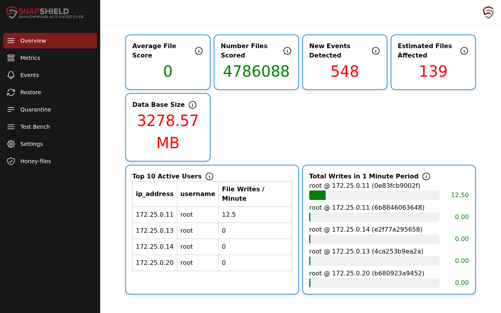
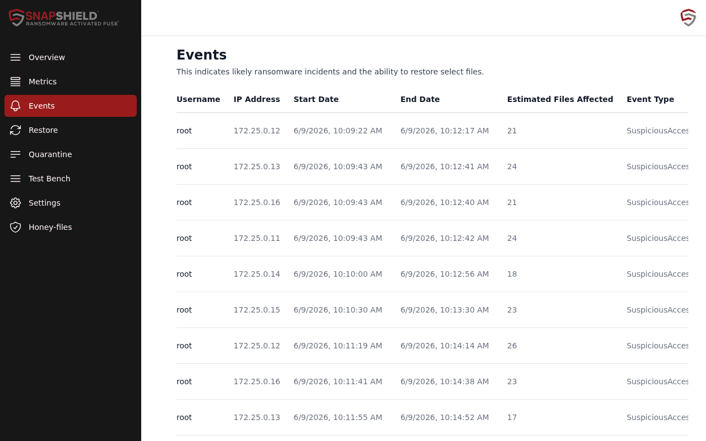
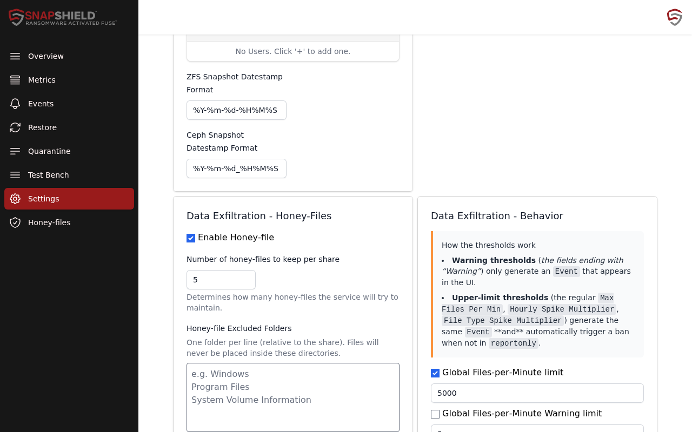

# SnapShield dashboard guide

This guide is for administrators using the SnapShield dashboard on a protected file server. It describes each page of the dashboard and the Cockpit plugin's **Manage** menu.

## Opening the dashboard

- **In Cockpit:** sign in at `https://<server>:9090` and select **Snapshield Dashboard** in the menu.
- **Standalone:** browse to `https://<server>:45677`.

Both use the same SnapShield login (the **UI username** and **UI password** set during setup). Your Cockpit login does not sign you in to SnapShield.

In Community, only the primary administrator account can sign in. See [Licensing](licensing.md).

## Cockpit Manage menu

Inside the Cockpit page, the **Manage** menu has two items:

- **Setup / change installation** opens the guided setup wizard. Use it to change configuration, add the Control Panel, or update SnapShield. Existing settings load automatically, and existing licensing is kept.
- **Connection settings** shows the local addresses the plugin uses to reach SnapShield on this host. You rarely need to change these. Saving here affects every Cockpit user on the host and needs **Administrative access**. **Use default** restores the defaults. **Back to Dashboard** returns to the product.

## Navigation

The left sidebar lists the pages below. On narrow screens it becomes a drawer.

### Overview

A quick health view of this server.

| Card | Shows |
|------|-------|
| Average File Score (72h) | Moving average of file scores over 72 hours. 0 means nothing suspicious. It turns red above 20. |
| Number Files Scored | Files scored since SnapShield started. |
| New Events Detected | Events that have not been resolved. |
| Estimated Files Affected | Files involved in unresolved events. |
| Data Base Size | Size of SnapShield's database. It warns above 3000 MB. |
| Top 10 Active Users | The busiest clients by Samba file writes per minute. |
| Total Writes in 1 Minute Period | Writes per minute by user, IP address and client name. |

### Snapshots

Shows snapshot information for your datasets. This page appears only on some installations.

### Metrics

More detail on scoring and file activity:

- Files scored, missed, and excluded (by rule, or because they were scored recently).
- Percentage of files scored in the last 24 hours.
- Historical events resolved and historical files affected.
- Top readers and writers, and charts of reads, writes and scores per second.

### Events

Lists unresolved events. Each row shows **Username**, **IP Address**, **Start Date**, **End Date**, **Estimated Files Affected** and **Event Type**.

- **View** opens the affected files on the **Restore** page.
- **Resolve** marks the event as handled.

If there is nothing to show, the page says "There are no unresolved events to be shown."

Resolved events stay visible for 30 days in Community. Longer history needs Enterprise. Unresolved events and recovery work in both editions.

See [Getting started](getting-started.md#5-what-a-detection-looks-like) for the list of event types.

### Restore

Find and recover files affected by an event.

1. Filter by **Username**, **IP Address**, **Start Date**, **End Date** or **File Path Search**. You can also limit the list to **Restorable** or **Quarantinable** files.
2. Click **Filter**.
3. Restore a single file from its row, or select several and click **Restore Selected** or **Quarantine Selected**.

Restoring copies the file back from a snapshot. Quarantining moves the file to the quarantine directory chosen during setup.

### Quarantine

The **Quarantined Users** page lists IP addresses that SnapShield has banned.

- To ban an address by hand, enter it in **Enter Ban Ip** and click **Ban**.
- To lift a ban, click **Unban** next to the address.

### Test Bench

Run safe tests on a Samba share. SnapShield creates a new folder on the share for the tests. You can delete it afterwards.

**Fire Drill (Containerized)** simulates a ransomware run from inside a container with its own IP address, so SnapShield bans the container and not your server.

1. Enter the **Server IP** (leave it empty for this host), **Share Name**, **Username** and **Password** for the share.
2. Click **Mount**.
3. Click **Initialize Data** to create test files.
4. Click **Encrypt** to start the simulated attack. SnapShield should detect it and ban the container.
5. Click **Decrypt**, then **Unban Container**, then **Cleanup** and **Unmount** when you're done.

**Load Test** generates file activity on a mounted share so you can see SnapShield's behaviour under load.

### Settings

Click **Save** to store changes. Click **Restart** to restart the detection service when a change needs it.

**Overrides Rules**

- **Ignore Rules:** paths (relative to the share) and share names that are not scored.
- **White List IPs:** IP addresses that will never be banned.
- **White List Users:** users that will never be banned.
- **ZFS Snapshot Datestamp Format** and **Ceph Snapshot Datestamp Format:** must match how your snapshots are named. SnapShield uses them to find snapshots.

Exclusions and allowlists remove activity from protection. Only add trusted exceptions.

**Tunables:** scanner settings such as **Entry Queue Thread Count** and **Data Base Log Entries Retention In Minutes**. Leave these at their defaults unless support asks you to change them.

**Data Exfiltration - Honey-Files**

- **Enable Honey-file:** turns decoy files on or off.
- **Number of honey-files to keep per share:** SnapShield tries to keep this many on each share.
- **Honey-file Excluded Folders:** one folder per line, relative to the share. Honey-files are never placed there.
- **Honey-file Definitions (static):** decoy files that must always exist. Give each a **Name**, **Extension** and **Size (KiB)**. Realistic names such as `Q4_Financial_Summary.xlsx` work best.

**Data Exfiltration - Behavior**

Each threshold has a ban limit and an optional **Warning** limit. Warning limits only create an event. Ban limits create an event and ban the client, unless SnapShield is in report mode.

| Setting | Triggers when |
|---------|---------------|
| Global Files-per-Minute limit | Any client reads or writes more files per minute than the limit. |
| User Specific Hourly File Read Count Multiplier | A user's hourly reads exceed their normal baseline times this multiplier. |
| User Specific Hourly File-Type Read Count Multiplier | A user's reads of one file type exceed their baseline times this multiplier. |
| Minimum Profile Age (days) | Behaviour alerts are not raised for a user until this many days of history exist. |

Honey-files and exfiltration thresholds are included in both Community and Enterprise.

### Honey-files

Lists every decoy file SnapShield has placed. Columns include **Path**, bait type, size, created, updated, last verified, and **Status**.

- **Present** means the file exists and was verified.
- **Missing** (red) means the file was deleted or moved. Check **Events** for a matching Honeyfile event straight away.

Use the search box to filter, and **Refresh** to reload.

### License

Shows this server's tier (Community or Enterprise), enrollment, license, start and expiry dates. Use it to import a license or export an activation request. See [Licensing](licensing.md).

### Logout

Open the user menu in the top-right corner and select **Logout**.
