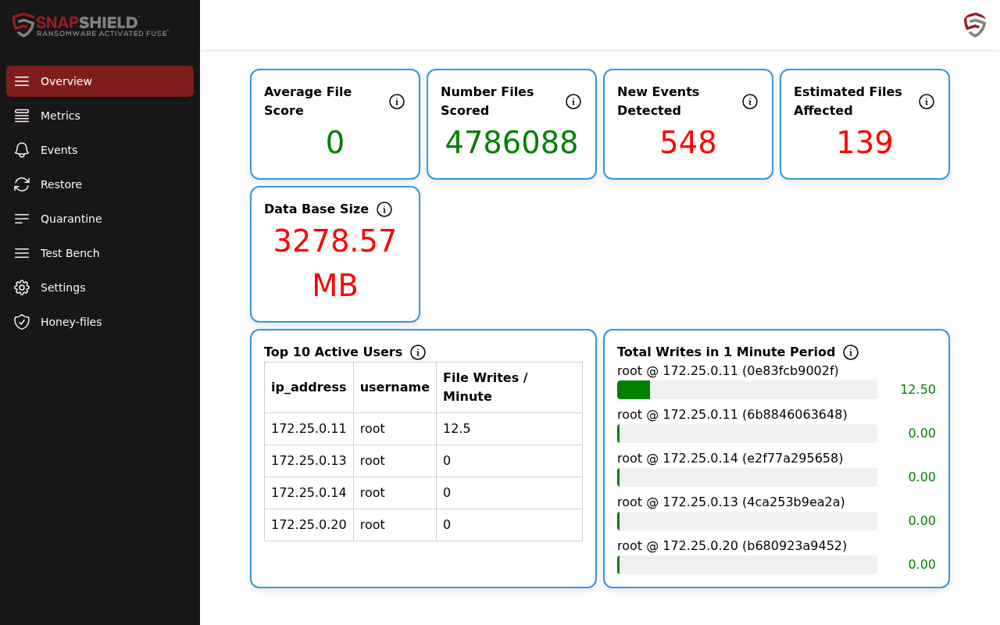
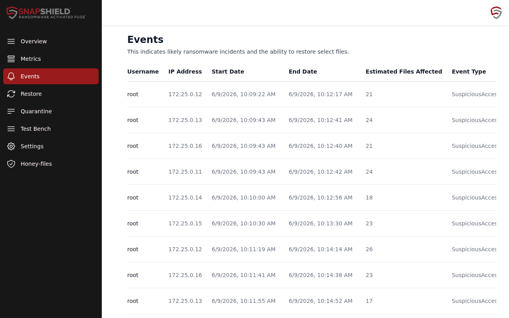

# Getting started

This guide is for administrators who have just finished [installation](installation.md). It covers your first sign-in, connecting your shares, what a detection looks like, and the first settings to review.

## How SnapShield works

SnapShield watches file activity on your Samba (SMB) shares and gives each changed file a score. Files that look encrypted, unusual access patterns, and touches on decoy "honey-files" all raise **events**. Depending on your settings, SnapShield either reports the event or also **bans** the client's IP address. Snapshots of your storage give SnapShield a known-good reference, so you can restore affected files afterwards.

## 1. Open the dashboard

When the setup wizard finishes, the **Results** step shows **Setup completed** and an **Open SnapShield Dashboard** button.

You can also open it any time:

1. Sign in to Cockpit at `https://<server>:9090`.
2. In the Cockpit menu, select **Snapshield Dashboard**.

The dashboard has its own login, separate from Cockpit. Sign in with the **UI username** and **UI password** you entered in the wizard's **Configuration** step.

> SnapShield also serves a standalone web interface at `https://<server>:45677`. It is the same dashboard and uses the same login.

## 2. Turn SnapShield on for your shares

SnapShield only sees activity on shares that load its Samba module. For each share you want to protect, add this to the share's settings:

```
vfs objects = snapshield
```

In Houston, open **Samba File Sharing**, edit the share, and add the line under **Advanced Settings**. If you manage `smb.conf` by hand, add it to the share's section. If the share already has a `vfs objects` line, add `snapshield` to the existing list.

## 3. Make sure snapshots exist

SnapShield compares files against your storage snapshots. Without snapshots it cannot score files accurately or restore them.

- On ZFS, set up a snapshot or replication task for each pool. In Houston this is in the **ZFS** module.
- On Ceph, make sure CephFS snapshots are being taken.
- You may need to take one snapshot by hand to confirm everything works.

SnapShield checks for new snapshots every 30 seconds. If your snapshot names use a custom date format, set it in **Settings → ZFS Snapshot Datestamp Format** or **Ceph Snapshot Datestamp Format**.

## 4. Check that files are being scored

1. Map a protected share on a workstation.
2. Copy some files to it.
3. Within moments, **Number Files Scored** on the **Overview** page goes up.



Some cards may show "No data" until there is activity to report. This is normal.

## 5. What a detection looks like

When SnapShield detects suspicious activity:

- A new row appears on the **Events** page with the username, IP address, start and end time, estimated files affected and event type.
- **New Events Detected** and **Estimated Files Affected** on the **Overview** page go up and turn red.
- If the event action is **ban**, the client's IP address appears on the **Quarantine** page.
- If you set up email alerts, an alert email is sent.



The main event types are:

| Event type | Meaning |
|------------|---------|
| Encrypting | File contents look encrypted. Possible ransomware. |
| SuspiciousAccess | Access pattern consistent with ransomware. |
| Honeyfile | A decoy honey-file was opened, changed or deleted. |
| AccessWarning | Raised file scores, not yet confirmed as ransomware. |
| StaticRateAlert / StaticRateWarning | A client went over the files-per-minute limit. |
| HourlySpikeAlert / HourlySpikeWarning | A user read far more files than their normal hourly baseline. |
| FileTypeSpikeAlert / FileTypeSpikeWarning | A user suddenly read many files of one type. |

"Alert" types can trigger a ban. "Warning" types only create an event.

### Responding to an event

1. On **Events**, click **View** to see the affected files on the **Restore** page.
2. Investigate the user and IP address. Decide whether the activity is real.
3. Restore or quarantine affected files from **Restore**.
4. If the IP address was banned and the client is now clean, unban it on **Quarantine**.
5. Click **Resolve** on the event.

See the [dashboard guide](dashboard.md) for each page in detail.

## 6. First things to configure

Work through these after your first sign-in. All of them are in **Settings** unless noted. Click **Save** after changes, and **Restart** when a change needs the detection service to reload.

1. **Allowlist trusted clients.** Add backup servers and other heavy, trusted clients to **White List IPs** or **White List Users**, so normal bulk activity is not banned.
2. **Exclude noisy paths.** Add **Ignore Rules** for share paths you don't want scored.
3. **Turn on honey-files.** Under **Data Exfiltration - Honey-Files**, tick **Enable Honey-file** and set how many to keep per share. Three to five per share is a good start.
4. **Review exfiltration thresholds.** Under **Data Exfiltration - Behavior**, set warning thresholds below the ban thresholds so you get early warnings.
5. **Check the event action.** The wizard's **On detected ransomware event** setting is either **ban** or **report**. Report mode lets you watch for false positives before turning on automatic bans. To change it, run **Manage → Setup / change installation** again.
6. **Email alerts.** Email is configured in the wizard's **Configuration** step under **Show advanced fields (alerts)**.
7. **Run a fire drill.** Use **Test Bench** to simulate ransomware safely and confirm detection works end to end.
8. **Check your license.** New servers run the free Community edition. See [Licensing](licensing.md) to apply an Enterprise trial or subscription.

## Next steps

- [Dashboard guide](dashboard.md)
- [Control Panel guide](control-panel.md), if you manage several servers
- [Troubleshooting](troubleshooting.md)
