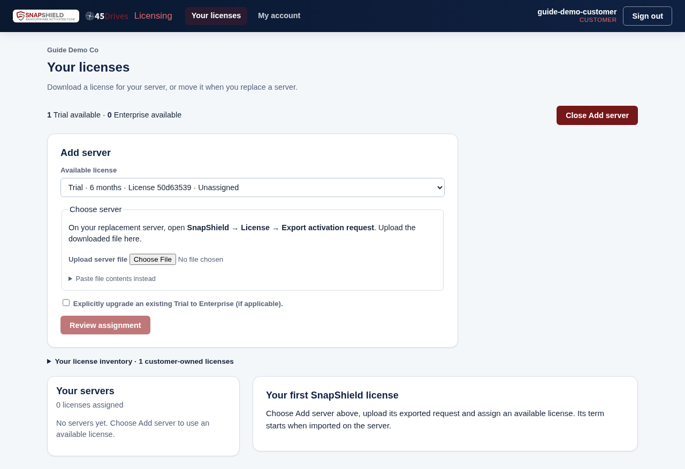
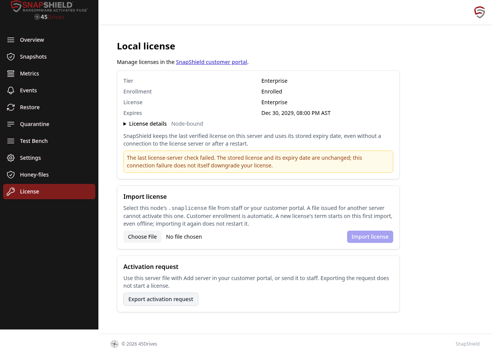
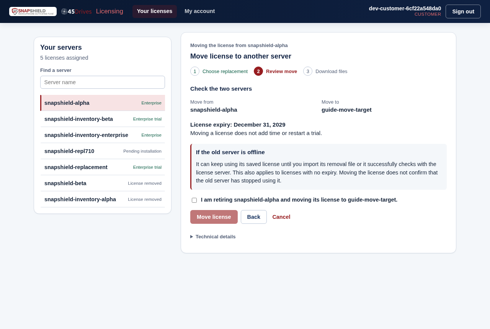

# Licensing

This guide is for customers who run SnapShield. It explains the Community and Enterprise editions, Enterprise trials, and how to apply, renew or move a license.

## Key points

- SnapShield is licensed **per protected server**. Each server, including each protected cluster member, needs its own license.
- Without a license, a server runs the free **Community** edition. Core ransomware protection always works.
- Client and connection counts are unlimited in both editions. There are no per-client or per-share fees.
- The Control Panel does not need a license of its own. To manage a server through it, that server must be on Enterprise.
- If an Enterprise license expires or is removed, the server drops back to Community. Your protection keeps running and your settings are kept.

## Community and Enterprise

### Included in both editions

- Ransomware and honey-file detection, with automatic blocking.
- One protected server or cluster.
- Real-time events: unresolved events and recently resolved ones.
- File recovery: single or batch restore of an event you can see.
- Manual resolve and unban.
- Email notifications.
- Data exfiltration alerts and custom exfiltration thresholds.
- Per-share exclusion rules and IP/user allowlists.
- Fire drills.
- 30 days of resolved event history.
- Community support (the [45HomeLab Forum](https://forum.45homelab.com/) and documentation).

### Added by Enterprise

- Multiple protected servers and clusters, each with its own license.
- Resolved event history beyond 30 days.
- Historical recovery search across your full history. Ordinary restore of a visible event is free in both editions.
- Multiple admin users. In Community only the primary admin can sign in to the dashboard.
- Central management in the [Control Panel](control-panel.md), with role-based access, an audit log and CSV exports.
- 45Drives services (paid Enterprise only, not trials): initial configuration, analysis and tuning, guided fire drills, and file restore by the 45Drives team.

### What happens in Community

- Protection, detection, blocking, recovery of visible events, email, exclusions, allowlists and fire drills keep working.
- Historical recovery search is not available.
- Resolved events are shown for a rolling 30 days.
- Only the primary admin can sign in. Other admin accounts, and their open sessions, are suspended until Enterprise is active again. If no admin is marked as primary, the oldest active admin account is treated as primary.

## License types

| You see | Meaning |
|---------|---------|
| Enterprise trial | A free, time-limited Enterprise license, normally six months. Available once per server. |
| Enterprise | A paid subscription with a fixed expiry date. |
| Removed | The license was revoked on this server. It is now on Community. |
| Community | No active Enterprise license. |

Rules that apply to every license:

- **The term starts on first import, not on download.** The clock starts when you import the file on the server, even if the server is offline.
- **A trial never restarts.** Reinstalling, re-activating, renewing or moving a license does not restart a trial.
- **Licenses are tied to one server.** A license file for one server will not activate another.
- **Works offline.** The server checks the license itself. If it can't reach the license server, a valid license stays valid and keeps its expiry date.

## Your customer portal account

There is no public sign-up. Your 45Drives contact creates your customer account and gives you the portal address, a username and an initial password.

Sign in on the **Customer sign in** page. If you were given a temporary password, you must choose a new one first: 12 or more characters. Changing your password signs out your other sessions.

## Apply a license to a server

### 1. Export the server's activation request

1. On the server, open SnapShield and go to **License**.
2. Click **Export activation request** and save the file.

Exporting a request does not start a license.

### 2. Assign a license in the customer portal

1. Sign in to the customer portal. The top of the page shows what you have available, for example "1 Trial available · 0 Enterprise available".
2. Click **Add server**.
3. Under **Available license**, choose a Trial or Enterprise license.
4. Under **Choose server**, upload the activation request file.
5. If you are converting a server's existing trial to a paid license, tick **Explicitly upgrade an existing Trial to Enterprise (if applicable)**.
6. Click **Review assignment**, read the summary, then click **Assign license**.

If the portal says **"Export a new server request from an upgraded SnapShield server."**, that server's SnapShield is too old. [Upgrade it](upgrading.md), then export and upload a new request.

### 3. Import the license on the server

1. In the portal, select the server and click **Download license**. This saves a `.snaplicense` file.
2. On the server, go to **License**, choose the file and click **Import license**.
3. You see **License imported**. The server is now on Enterprise and the term has started.

If you use the Control Panel, an admin can also import the file from the Control Panel's **Licensing** page. See [Control Panel guide](control-panel.md#licensing).

## The License page

On every server, **License** shows:

- **Tier:** Community or Enterprise.
- **Enrollment:** whether this server is registered.
- **License:** Enterprise trial, Enterprise or Removed.
- **Started** and **Expires:** shown in your browser's time zone.
- **License details:** Node ID, customer and license allocation.

The page also has:

- **Import license:** load this server's `.snaplicense` file.
- **Export activation request:** the file you upload when adding or replacing a server.
- **Export activation record:** available after you import a license with a term. It is not a license. For a server with no internet access, upload it in the portal to confirm the original start and expiry dates.

### Notices you may see

| Notice | What it means |
|--------|---------------|
| Expires in 30 / 7 / 1 days | Renew to keep Enterprise. Protection continues in Community. |
| Expired | Enterprise has ended. Protection continues in Community until you import a new license. |
| Revoked | This server's Enterprise license was removed. Protection continues in Community. |
| Not yet valid | The license start date hasn't arrived. Community applies until then. |
| Clock error | The server clock moved backwards. SnapShield uses the later of the current or last-seen time until the clock is fixed. |
| Last license-server check failed | The server couldn't reach the license server. The stored license and expiry are unchanged. |

A red "local license" error means the page couldn't read this server's license file. It does not mean Enterprise has expired.

## Move a license to a replacement server

You can move a license yourself when you retire a server. The license must have been imported on its first server before you can move it.

1. On the new server, export an activation request (**License → Export activation request**).
2. In the portal, select the old server and click **Move license to another server**.
3. Upload the new server's activation request. You can't move a license onto a server that already has one.
4. Click **Review move**. Check the two servers and the license expiry. Moving does not add time or restart a trial.
5. Tick **I am retiring … and moving its license to …** and click **Move license**.
6. Download both files:
   - **Download new server license:** import it on the new server.
   - **Download old server removal file:** import it on the old server, if you can still reach it.

An offline old server can keep using its saved license until you import the removal file or it checks in with the license server.

You don't need the old server to move the license. If the portal doesn't know the license's original start date, upload the old server's activation record first.

## Renewing

- Downloading or moving an **Expired** license does not bring Enterprise back.
- If you have an unassigned Enterprise license, use **Add server** with the expired server's activation request, then import the new file.
- Otherwise, contact your 45Drives representative for a renewal, then import the new license on the server.

## Offline servers

- The server keeps its last verified license and expiry date, with or without a connection and across restarts.
- A failed connection never clears, downgrades or extends a valid license.
- For an air-gapped server, upload its activation record in the portal (**Upload activation record**) to confirm its dates.
